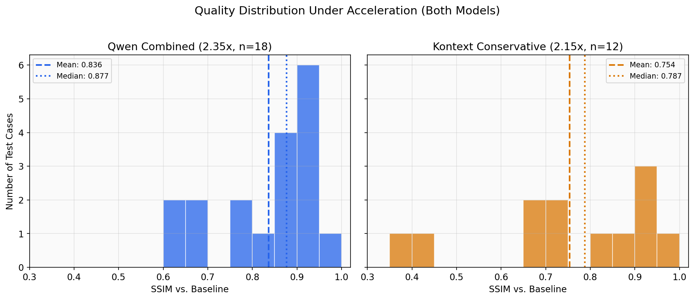
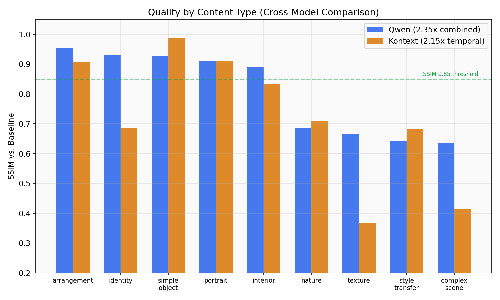
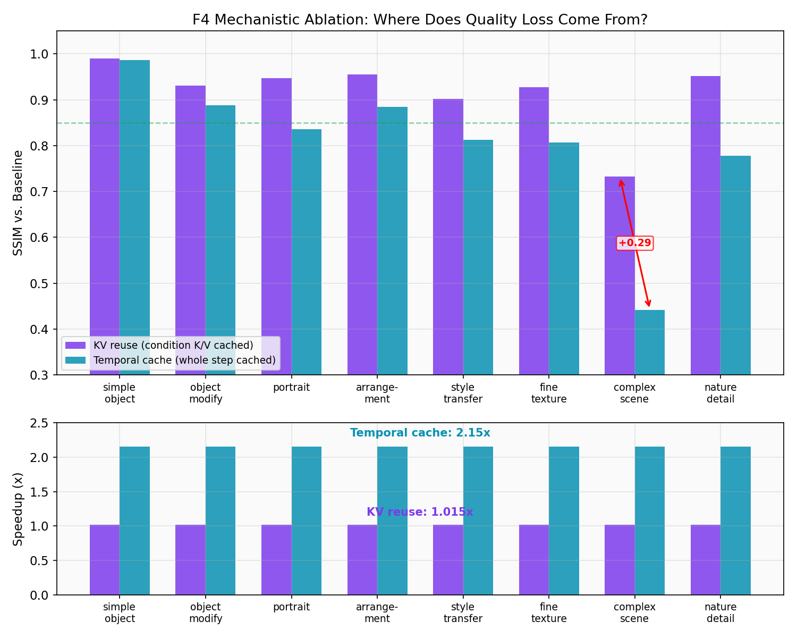

# Inference Acceleration for Multi-Image Conditional Editing

Experimental study of temporal step-caching and CFG reduction for accelerating flow-matching diffusion pipelines used in conditional image editing. Tested on two architecturally distinct models:

- **Qwen-Image-Edit-2511** (19.5B transformer, true CFG, 40 steps, multi-image)
- **FLUX.1 Kontext-dev** (12B transformer, guidance-distilled, 28 steps, single-image)

**Status**: Experimental phase complete (M0-M9 Qwen track, F0-F4 FLUX track). The method is a validated prototype with known quality characteristics, not a deployed system.

## Problem

Multi-image conditional editing with flow-matching models is computationally expensive. Qwen-Image-Edit requires 80 transformer passes per image (40 steps x 2 for CFG), taking ~47s on an NVIDIA B200. Kontext-dev requires 28 passes, taking ~9s. Both pipelines concentrate >97% of cost in the denoising loop, with attention dominating at ~75% of block time.

## Key Finding: Temporal Plateau Is Structural

Both models exhibit an identical three-phase temporal redundancy pattern: convergence, plateau, divergence. During the plateau, consecutive denoising steps produce near-identical noise predictions (cosine similarity > 0.999) for 65-74% of the trajectory.

This pattern is not model-specific --- it appears on architecturally distinct models with different guidance strategies (true CFG vs. guidance-distilled), different step counts (40 vs. 28), and different parameter counts (19.5B vs. 12B). Both models use the FlowMatchEulerDiscreteScheduler, which is a shared confound that cannot be ruled out as a contributing factor with only n=2 models.


## Method

**Temporal step-caching**: During the plateau, reuse the previous step's complete noise prediction instead of running the transformer. This is a noise-prediction-level cache operating above the transformer --- no architectural modifications required.

**CFG-skip** (Qwen only): During the plateau, skip the unconditional transformer pass. Conditional and unconditional outputs are near-identical (cosine similarity > 0.999) for steps 3-38, making the unconditional pass redundant.

Qwen's combined schedule (temporal + CFG-skip):

| Steps | Action | Passes per step |
|---|---|---|
| 0-4 | Full compute (conditional + unconditional) | 2 |
| 5-9 | CFG-skip (conditional only) | 1 |
| 10-25 | Temporal cache (reuse previous prediction) | 0 |
| 26-34 | CFG-skip (conditional only) | 1 |
| 35-39 | Full compute | 2 |

Kontext uses temporal caching only (no CFG axis available due to guidance distillation).

## Results

### Cross-Model Comparison

| Dimension | Qwen (combined, 2.35x) | Kontext (temporal, 2.15x) |
|---|---|---|
| Acceleration axes | CFG + temporal | Temporal only |
| Mean SSIM | 0.836 (n=18) | 0.754 (n=12) |
| SSIM >= 0.90 | 39% | 33% |
| SSIM < 0.80 | 33% | 50% |
| Bimodal distribution | Yes | Yes |
| Baseline time (1-image) | 26.5s | 8.9s |
| Accelerated time (1-image) | 11.2s | 4.1s |

Qwen achieves higher speedup AND better quality than Kontext because it distributes quality cost across two independent axes. The combined method does not compound quality loss --- observed SSIM (0.836) exceeds predicted-independent SSIM (0.753) because the two axes degrade the same content types.

Kontext's lower absolute SSIM is explained by three factors: single-axis loading (entire quality cost on temporal caching alone), weaker error correction (milder final-step divergence provides less trajectory correction), and F2's test suite containing proportionally harder cases.


### Quality Distribution

The quality distribution is bimodal on both models. Content separates into a robust cluster (structural/semantic edits) and a fragile cluster (fine-detail edits):

**Robust** (SSIM 0.85-0.99): Object placement, portraits, arrangements, simple objects, interior design. Layout and semantic content are established in the early full-compute steps and survive acceleration.

**Fragile** (SSIM 0.37-0.80): Style transfer, fine texture, complex scenes, nature detail. These edits depend on mid-trajectory refinement steps that acceleration prunes.

The same content types degrade on both models (4/4 fragile types overlap, 4/4 robust types overlap), providing evidence that this quality boundary is a property of the caching method, not model-specific. Difficulty is the strongest predictor: easy cases average SSIM 0.94/0.89 (Qwen/Kontext), medium 0.89/0.83, hard 0.75/0.54. The medium-to-hard drop is 2-4x larger than easy-to-medium.





### Mechanistic Insight (F4): Where Quality Loss Comes From

An ablation experiment on Kontext isolated the source of quality degradation. Caching only the conditioning-token K/V projections (text + reference image tokens, 53% of the attention sequence) while recomputing everything else yields SSIM 0.917 with negligible speedup (1.015x). Whole-step temporal caching yields SSIM 0.804 with 2.15x speedup.

The gap (+0.112 SSIM) identifies the quality bottleneck: quality loss comes from stale attention matmuls (Q x K^T, attn x V) and FFN computations, not from stale conditioning K/V. The conditioning tokens change 3-5x less than noise tokens across the plateau and contribute negligibly to output degradation.

This means future improvement should target partial attention recomputation (e.g., recomputing only noise-query attention while reusing condition-query results), not finer-grained K/V caching. Such decomposition would require custom kernels incompatible with FlashAttention.



### Qwen Ablation Summary

| Configuration | Speedup | Mean SSIM | Mean LPIPS |
|---|---|---|---|
| CFG-skip only | 1.60x | 0.851 | 0.170 |
| Temporal cache only | 1.67x | 0.885 | 0.143 |
| Combined | 2.35x | 0.836 | 0.215 |

Temporal caching is the stronger single axis. CFG-skip's primary value is additive speedup when combined (+0.686x additional at -0.049 SSIM cost).

## Limitations

- **n=2 models**: The temporal plateau transfer claim is based on two models sharing the same scheduler (FlowMatchEulerDiscreteScheduler). Testing on a model with a different flow-matching scheduler would strengthen the structural claim.
- **Proxy metrics**: SSIM and LPIPS are proxies for perceptual quality. Human evaluation is needed to validate whether measured differences correspond to user-perceived quality.
- **Fixed schedules only**: The recommended operating points use fixed caching schedules. Content-adaptive routing --- selecting between full and accelerated compute based on edit complexity --- is an open direction.
- **Test suite size**: 18 cases (Qwen) and 12 cases (Kontext) establish directional findings but are insufficient for statistical significance tests.
- **Quality ceiling**: Schedule-based acceleration achieves 2.0-2.5x speedup with acceptable quality for structural content. Reaching higher speedup or extending to fine-detail content requires fundamentally different approaches (partial attention recomputation, learned cache policies, or content-adaptive routing).

## Open Directions

1. **Content-adaptive routing**: Use difficulty or content-type signals to select between full compute and accelerated mode at runtime.
2. **Partial attention recomputation**: Recompute Q x K^T for noise queries while reusing condition-query attention results (requires custom CUDA kernels).
3. **Third-model validation**: Test on a flow-matching model with a different scheduler to separate method properties from scheduler properties.
4. **Human evaluation**: Validate whether SSIM-measured quality differences correspond to user-perceived quality.

## Repository Structure

```
scripts/
  qwen/                        # Qwen-Image-Edit track (M0-M9)
    m1_feasibility.py           # Environment + loading feasibility
    m3_profile.py               # Three-level denoising profiling
    m4_redundancy.py            # Temporal + CFG redundancy characterization
    m5_cfg_skip.py              # CFG-skip prototype (+ v2 variant)
    m6_temporal_cache.py        # Temporal step-caching prototype
    m7_multi_image.py           # Multi-image conditioning analysis
    m8_combined.py              # Combined acceleration prototype
    m9_validation.py            # 18-case validation + ablation study
  flux/                        # FLUX Kontext-dev track (F0-F4)
    architecture_notes.md       # Kontext architecture reference
    f1_baseline.py              # Baseline + profiling
    f1_profile.py               # Structured profiling
    f1_redundancy.py            # Temporal redundancy characterization
    f1_temporal_cache.py        # Temporal cache transfer test
    f2_validation.py            # 12-case validation study
    f2_results.csv              # F2 raw results
    f4_kv_cache_prototype.py    # Conditioning-aware KV reuse prototype
    f4_kv_measurement.py        # K/V stability measurement
  generate_plots.py            # Visualization generation script
docs/
  results.md                   # Full results tables (M9, F2, F3, F4)
  milestone_summary.md         # One-paragraph summary per milestone
  plots/                       # Generated visualizations
  examples/                    # Curated baseline vs. accelerated comparisons (Qwen)
findings.md                    # Detailed experimental findings and analysis
progress.md                    # Session-level progress log
task_plan.md                   # Milestone planning document
Qwen-Image/                    # Upstream model reference (code only)
```

## Hardware

All experiments run on NVIDIA B200 (183 GB VRAM). Qwen: 57.76 GB model, 63.20 GB peak. Kontext: 34.4 GB model, 37.5 GB peak. Both loaded in bf16 without quantization or offloading.

## Example Outputs (Qwen)

See [docs/examples/](docs/examples/) for curated baseline vs. accelerated comparisons, including both success cases (SSIM > 0.94) and failure cases (SSIM < 0.67). Kontext output images are not included in the repository; quality is characterized numerically in [docs/results.md](docs/results.md).
