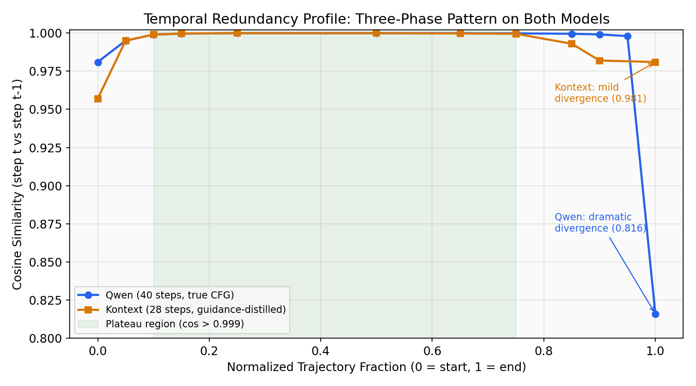
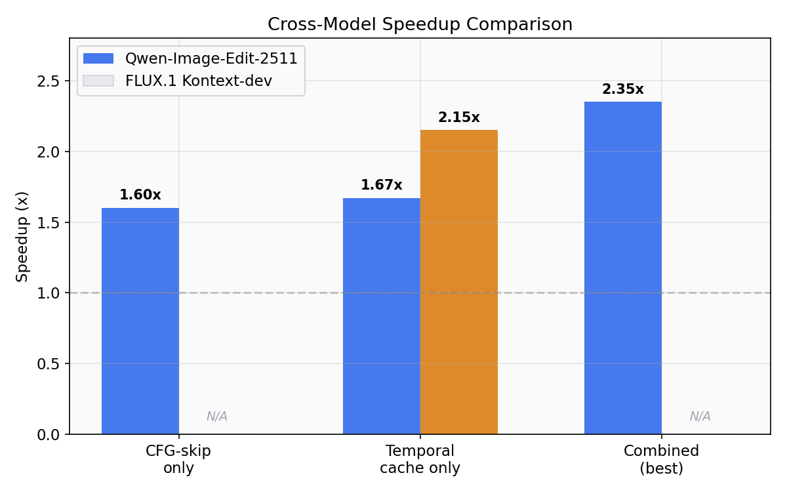
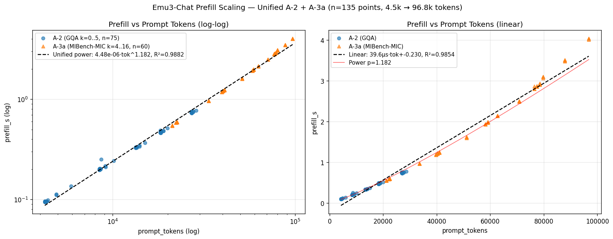
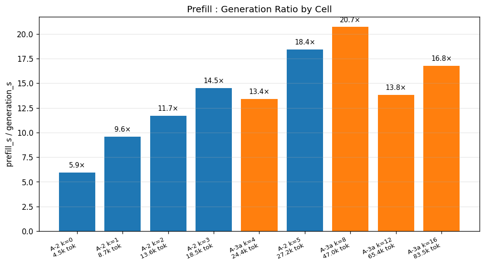
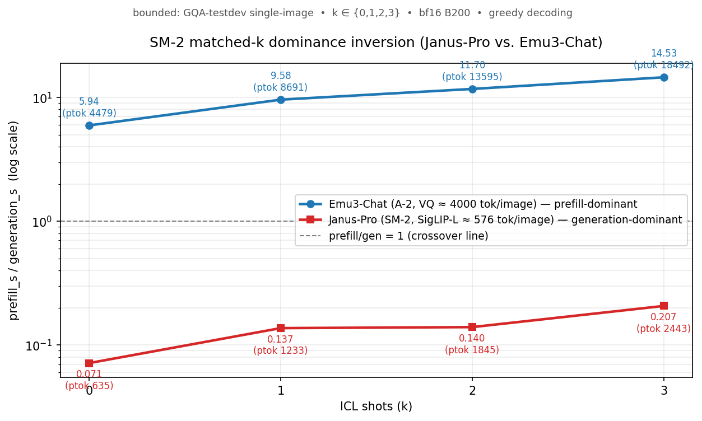

# Inference Acceleration for Visual Language Models

An experimental study of **where inference cost actually goes** in modern visual
language models, and which interventions convert that cost into wall-clock
speedups that generalize across architectures. The project spans two model
families (diffusion-based flow-matching editors and autoregressive multimodal
transformers) and has recently pivoted from a *method-first* posture to a
*pain-first* posture after the autoregressive track surfaced that library-level
substrate effects were dominating the apparent gains.

All measurements are on **NVIDIA B200 (183 GB VRAM)**, bf16 weights, no
quantization.

## Executive summary

| Track | Model(s) | What we shipped | Status |
|---|---|---|---|
| DiT (flow-matching image edit) | Qwen-Image-Edit-2511 (19.5B), FLUX.1 Kontext-dev (12B) | Temporal step-caching + CFG-skip; 2.35× (Qwen) / 2.15× (Kontext) at SSIM 0.836 / 0.754; mechanistic ablation isolating the quality bottleneck (F4) | **Completed** |
| AR (autoregressive VLM ICL) | Lumina-mGPT-2.0-Omni (7B, Chameleon) | Characterization (AR-1), KV compression (AR-2), sparse prefill (AR-3), prefix caching (AR-4), RoPE-pathology root-cause decomposition (AR-5), understanding-task probe (AR-UND) | **Completed / frozen** |
| AR-6 / SAICL prototype | Lumina-mGPT-2.0-Omni | Structured demo-attention + reversed-pyramid layer retention (prototype) | **Frozen** — not mainline |
| Phase A / D-1 | Emu3-Chat (understanding regime) | Anchor validation passed, prefill/generation scaling law characterized (n=135, 4.5k–96.8k tokens, O(n^1.18)) | **Frozen** as clean control baseline |
| D-2a (bounded branch) | Emu3-Gen (generation regime) | Stage-2 (35% over-window) and Stage-2A (within-window) colorization probes on the tested zero-shot prompt shape | **In PI branch re-judgment** after a window-clean negative checkpoint |
| SM-1 (second-model discrimination pilot) | Janus-Pro 7B | Bottleneck-shape contrast vs Emu3 D-1 baseline; generation-dominant at k=0/1 (prefill/gen ≈ 0.12 / 0.14) | **Completed** as bounded Round-1 pilot |
| SM-2 (bottleneck-shape verification) | Janus-Pro 7B | 36-measurement token-matched sample at k ∈ {0,1,2,3}; 36/36 dominance-inversion against nearest Emu3 A-2 | **Completed** (low-token understanding-side verification) |
| SM-3 (token-overlap gap-closure) | Janus-Pro 7B | k ∈ {4,5,6,7} ladder intended to produce a token-overlap match with Emu3 A-2 | **Paused at continuity gate, unresolved** — not a branch closure, not a final scientific negative |

For the configuration-bound current state, see
[`docs/current_project_state.md`](docs/current_project_state.md). Full DiT/AR
result tables are in [`docs/results.md`](docs/results.md) and
[`docs/milestone_summary.md`](docs/milestone_summary.md).

## Why this matters

Inference cost on modern VLMs concentrates in two very different places
depending on the decoding regime:

- On **flow-matching diffusion** pipelines, denoising steps dominate wall-clock
  (97–99%) and exhibit a surprisingly long structural plateau where consecutive
  steps produce near-identical outputs.
- On **autoregressive multimodal transformers** with in-context demos, prefill
  scales superlinearly, and per-token generation cost grows with the larger KV
  cache — so adding one demo image can turn an 83 s generation into a 571 s
  generation on the same model.

These are two different forms of the same underlying question: *which computation
can we safely not do, at what quality cost, and where is the quality bottleneck
when we cut?* The DiT track answered that question constructively. The AR track
answered it cautionarily: our apparent 5× speedup from prefix caching turned
out to be a library-side pathology, not a method, and that finding drove the
shift to a pain-first diagnostic program on a different model family.

## Project evolution: from method-first to pain-first

The project ran in four overlapping phases:

1. **Method-first (DiT track, completed).** Profile a flow-matching pipeline,
   identify a structural redundancy (temporal step similarity at cos > 0.999
   for 65–74% of the trajectory), exploit it with a step-caching prototype,
   validate the transfer across a second, architecturally distinct model
   (Kontext). Result: a clean, transferable acceleration pattern with a
   mechanistic ablation (F4) that localizes the quality bottleneck to stale
   attention matmuls and FFN rather than stale conditioning K/V.

2. **Method-first (AR/Lumina track, completed / frozen).** Port the same
   mindset to an autoregressive VLM with in-context demos. Characterize where
   the attention actually goes (AR-1), target low-demo-attention heads with
   compression (AR-2) and sparse prefill (AR-3), extend to longer contexts
   with position encoding extension and prefix caching (AR-4), and then
   *decompose the AR-4 speedup* (AR-5). AR-5 is the reason the project
   pivoted: the observed 5× from prefix caching was **entirely explained by a
   DynamicNTK RoPE recomputation pathology** inside the HuggingFace
   transformers implementation. Fixing the library eliminates the speedup
   motivation for caching on this architecture.
   AR-6 / SAICL (structured prefill + reversed-pyramid retention) was
   prototyped against the same Lumina substrate and is kept **frozen** here;
   it is not the mainline path forward.

3. **Pain-first (Emu3 track, current).** Before proposing another method,
   measure on a different model family and pin down the empirical bottleneck
   in the understanding regime first. D-1 freezes Emu3-Chat as a clean
   understanding-regime control baseline, with a full prefill / generation /
   peak-VRAM scaling characterization on 135 configurations. D-2a is a
   bounded side-audit of Emu3-Gen's generation capability on a zero-shot
   colorization prompt; its role in the program is to confirm or remove one
   specific confound (Stage-2 context-window overflow) before any broader
   generative methodology is considered.

4. **Cross-family discrimination (Janus-Pro track, current).** Port the
   bottleneck-shape question to a second model family under bounded packets.
   SM-1 establishes that Janus-Pro inverts the Emu3 dominance structure on
   matched understanding (generation-dominant at k=0/1, prefill-dominant on
   Emu3), attributable to image-tokenization budget rather than architecture
   proper. SM-2 verifies this direction-stability on a 36-measurement
   token-matched sample across k ∈ {0,1,2,3}. SM-3 attempted to close the
   token-overlap gap (walk Janus up to k ∈ {4,5,6,7}) but is paused at the
   per-query continuity gate; it is unresolved, not a branch closure.

## Visual summary

Five figures drawn from the frozen / bounded-complete result surface across
the three tracks (DiT, Emu3, Janus-Pro). All five are the presentation-level
visuals referenced by the narrative above; the underlying numeric tables
live in `docs/results.md` (DiT/AR), in the local D-1 deliverable tree (Emu3),
and in the local SM-2 deliverable tree (Janus-Pro).

### DiT track — the temporal plateau that both flow-matching models share



Two architecturally different flow-matching editors (Qwen-Image-Edit, 19.5B,
true CFG; FLUX.1 Kontext-dev, 12B, guidance-distilled) exhibit the same
three-phase trajectory: an initial converge phase, a long plateau with
consecutive-step cosine similarity above 0.999, and a final-step divergence
(dramatic on Qwen, milder on Kontext). The plateau region is what the
temporal-caching prototype exploits.

### DiT track — observed speedups (M9 / F2 validation)



On Qwen, CFG-skip and temporal-cache are two *independent* acceleration axes;
combining them gives 2.35× at SSIM 0.836 over 18 diverse cases. Kontext, with
no independent unconditional pass to drop, is single-axis only: 2.15× temporal
at SSIM 0.754 over 12 cases. Quality is bimodal in both models (structural
edits are robust, fine-detail / style / texture are fragile); see
[`docs/results.md`](docs/results.md) for the per-case ablation.

### Emu3-Chat — prefill scaling (D-1 anchor)



Unified A-2 (GQA scaling, k=0..5) and A-3a (MIBench, k=4..16) prefill
measurements over 135 configurations spanning 4.5k–96.8k prompt tokens on
Emu3-Chat. The unified power-law fit is prefill ≈ 4.48e-6 · tok^1.182
(R² = 0.988) — i.e. prefill scales slightly superlinearly, and the two
independent sweep sources land on the same curve. This is the empirical
shape of the understanding-regime prefill bottleneck that motivates the
pain-first posture: the cost you pay to admit long multi-image contexts
grows faster than linear in tokens.

### Emu3-Chat — prefill : generation ratio by cell



At the short end (A-2, k=0, 4.5k tokens) prefill is already 5.9× the
generation time on a 32-token decode. By 47k tokens (A-3a, k=8) the ratio
hits 20.7×. On Emu3-Chat's understanding workload with short answers,
**prefill is the wall-clock.** The characterization is frozen under D-1 and
serves as the clean control baseline the D-2a generation audit and any
future second-model method must improve against.

### Janus-Pro vs. Emu3-Chat — matched-k dominance inversion (SM-2)



On the same ICL task (GQA-testdev single-image, k ∈ {0, 1, 2, 3}, bf16,
B200, greedy decoding), two VLMs sit on opposite sides of the prefill/gen
crossover line. Emu3-Chat (A-2; VQ ≈ 4,000 tokens/image) runs
prefill-dominant from 5.94× at k=0 to 14.53× at k=3. Janus-Pro
(SigLIP-L ≈ 576 tokens/image) stays generation-dominant from 0.072× at k=0
to 0.207× at k=3. The direction does not reverse on any of the four
k-levels. Attribution: image-tokenization budget — a ~7× shorter per-image
token footprint collapses Janus-Pro's prefill cost while leaving per-token
decode unchanged. This is the cross-family bottleneck-shape discrimination
the SM-2 packet was designed to verify; the 36-measurement token-matched
primary verdict (36 / 36 `dominance_inversion = yes`) is in
[`docs/results.md`](docs/results.md).

## Current scientific state

### D-1 — Emu3-Chat understanding-regime anchor (frozen)

Anchor validation returned `OVERALL_PASS` across the primary per-query gates
and per-cell secondary gates; the claim ledger is closed. The prefill /
generation / peak-VRAM scaling surface above is the D-1 deliverable.
The D-1 report and raw evidence are maintained locally under
`deliverables/d1_emu3_understanding_freeze/` (not part of git history; see
[`docs/storage_and_archive_notes.md`](docs/storage_and_archive_notes.md)).

### D-2a — Emu3 generation-capability bounded branch (PI re-judgment)

D-2a probed Emu3-Gen on a zero-shot colorization scaffold at two image-area
settings:

| Cell | Variant | Scaffold | `image_area` | Window regime | Gate A | Gate B | Gate C |
|---|---|---|---:|---|---|---|---|
| Stage 1 (depth) | chat | depth | 518400 | inside (131072 ctx) | PASS | FAIL | FAIL 8.60× |
| Stage 3 (colorization) | chat | colorization | 518400 | inside (131072 ctx) | PASS | FAIL | FAIL 8.49× |
| Stage 2 (colorization) | gen | colorization | 518400 | 35% over (9216 ctx) | PASS | FAIL | FAIL 7.23× |
| Stage 2A (colorization) | gen | colorization | 262144 | inside (9216 ctx, headroom 811) | PASS | FAIL | FAIL 4.00× |

**Configuration-bound conclusion (preferred wording):**

> On the tested zero-shot prompt shape and current colorization scaffold, the
> within-window re-probe remained Gate-B fail; this removes the Stage-2
> context-overflow confound for this configuration.

**What is not claimed.** No Emu3-Gen-wide inability. No Emu3-family-wide
inability. No claim about untested k, untested scaffolds, untested prompt
shapes, or untested decode paths. Gate C is substrate-bound at the current
decode path (DynamicCache grow-cat + SDPA on q_len=1); a `StaticCache` +
`torch.compile` path remains outside D-2a scope.

The branch has entered PI re-judgment. No active execution in this repo pass.

### SM-1 — Janus-Pro bounded second-model pilot (completed)

A bounded Round-1 pilot on Janus-Pro 7B (`deepseek-ai/Janus-Pro-7B`, pinned
revision `5c3eb3fb…`, fresh isolated venv, bf16 on B200, mandatory CodeX audit
cleared). Packet scope: bottleneck-shape characterization + capability sanity on
one model. Not a scaling study, not a method experiment.

The primary scientific output is the **dominance-structure contrast against
the Emu3-Chat D-1 baseline**. At matched understanding k ∈ {0, 1}:

| regime | Emu3-Chat (D-1) | Janus-Pro (SM-1 R2) |
|---|---|---|
| k=0 prefill/gen | **5.94×** (prefill dominates) | **0.115×** (generation dominates) |
| k=1 prefill/gen | **9.58×** (prefill dominates) | **0.141×** (generation dominates) |

Attribution: Janus-Pro's SigLIP-L vision tower uses ~576 LM positions per
image; Emu3-Chat's VQ tokenizer uses ~4,000 LM positions per image. The
~7× shorter prompt collapses prefill cost on Janus while leaving per-token
decode cost unchanged — generation naturally dominates on Janus, prefill on
Emu3. This shifts where the wall-clock lives without changing per-family
internal ordering.

SM-1 R3.1 (trivial text-to-image) was `usable` on its Gate B rubric; R3.2
(k=0 colorization) was `clearly_unusable` **strictly configuration-bound** to
the tested zero-shot prompt shape and the current colorization scaffold. This
is not a Janus-Pro-wide or family-wide inability claim.

### SM-2 — Janus-Pro Round 2: low-token understanding-side bottleneck-shape verification (completed)

A bounded Round-2 packet with two PI overrides (V1 continuity as ±20% mean
band on 1 warmup + 2 timed; V4 token-matched cross-family comparison as
primary verdict basis, matched-k auxiliary as appendix only). Mandatory
CodeX audit cleared 14/14 items. V1 continuity absorbed a cross-host/device
change (`c1003a-s5.ufhpc` GPU1 → `c1006a-s5.ufhpc` GPU0) within band.

On a **36-measurement token-matched sample at 4 k-levels** (k ∈ {0, 1, 2, 3},
3 queries × 3 timed runs per cell): **36 / 36 pairings show
`dominance_inversion = yes`** against the nearest-prompt-token Emu3 A-2 point.
The matched-k appendix extends the SM-1 k=0 / k=1 inversion to k=2 and k=3
at the same direction:


| k | Janus prefill/gen | Emu3 prefill/gen | Janus ptok | Emu3 ptok | inversion |
|---|---|---|---|---|---|
| 0 | 0.072 | 5.94 | 635 | 4,479 | yes |
| 1 | 0.137 | 9.58 | 1,233 | 8,691 | yes |
| 2 | 0.140 | **11.70** | 1,845 | 13,595 | yes |
| 3 | 0.207 | **14.53** | 2,443 | 18,492 | yes |

**Owned limitation (SM-2 V4 LARGE_GAP).** All Janus-Pro prompt tokens at
k=0..3 (~635–2443) fall below Emu3 A-2's smallest prompt (~4,242 tok at k=0),
so every token-matched pair is anchored at Emu3 k=0. The SM-2 verdict is
carried by direction-invariance on both sides of the pairing, not by
raw-number equivalence. This is the precise gap that SM-3 was designed to
close.

### SM-3 — Janus-Pro Round 3: token-overlap gap-closure attempt (paused at continuity gate, unresolved)

**Status: paused at the per-query continuity gate. Unresolved. Not a branch
closure. Not a final scientific negative.**

SM-3 is the bounded follow-on packet intended to close SM-2 V4's
`LARGE_GAP` limitation by walking Janus-Pro up the ICL ladder to
k ∈ {4, 5, 6, 7}, so that at least one cell produces a token-overlap match
with Emu3 A-2. The CodeX audit on the code cleared, and a PI-authorized
narrow delta audit additionally cleared the remediation code change.

The packet did not proceed past G1, the per-query continuity gate against
the SM-2 V2.k0 reference for the same query. No downstream SM-3 cells (G2
k-ladder, G3 token-overlap analysis) were executed; **no SM-3 scientific
claim is on record**. SM-3 is not treated as scientifically resolved in this
pass, and no further engineer-side continuity patching is being performed.

The SM-1 and SM-2 results above are unaffected by the SM-3 pause.

## DiT track: detail

**Temporal step-caching** reuses the previous step's noise prediction inside
the plateau region. On Qwen, we additionally apply **CFG-skip** (skip the
unconditional pass when conditional and unconditional outputs have converged).
The two axes compose additively on a true-CFG model.

**F4 mechanistic ablation.** Caching *only* the conditioning-token K/V (text +
reference image, ~53% of the attention sequence) preserves quality
(SSIM 0.917) but buys almost no time (1.015×) — the K/V projection savings
are dominated by the attention matmul that still runs at full cost. The
relevant quality bottleneck is stale attention matmuls and FFN, not stale
conditioning K/V. This localizes future quality-preserving methodology to
partial-attention recomputation, not K/V reuse.

Per-case results, ablation tables, and the cross-model failure overlap are in
[`docs/results.md`](docs/results.md); per-milestone narrative is in
[`docs/milestone_summary.md`](docs/milestone_summary.md); curated Qwen before /
after comparisons are in [`docs/examples/`](docs/examples/).

## AR track: detail (completed / frozen)

The AR track is kept in full here as *context for the pivot*, not as mainline
methodology.

**Baseline pain.** On Lumina-mGPT-2.0-Omni doing 1-shot depth estimation via
ICL on NYU Depth V2:

| Condition | Prompt tokens | ms/token | Total time | Slowdown |
|---|---:|---:|---:|---:|
| 0-shot | 2,129 | 39.9 | 83.0 s | 1.00× |
| 1-shot | 6,293 | 274.5 | 571.2 s | 6.88× |

Prefill growth and per-token generation cost both grow when you add a demo.

**AR-1 characterization.** Per-head attention profiling across 32×32 = 1024
heads during generation: 33% of total attention goes to demo-image tokens
(per-head range 0.7%–82.1%), with a strong layer gradient (shallow layers
attend little, deep layers attend heavily) and within-layer head
specialization (5%–80%).

**AR-2 / AR-3 (compression and sparse prefill).** Head-selective beats
uniform at matched sparsity. AR-2 best: SSIM 0.692 at 26.5% head budget;
AR-3 (milder because demo K/V is never modified) best: SSIM 0.905 at the same
26.5% budget — a +31% perceptual improvement over AR-2 for the same targeting
criterion. Neither produces a realized wall-clock speedup: prefill is only
0.3% of pipeline cost and KV compression doesn't reduce per-token generation.

**AR-4 prefix caching + Dynamic NTK extension.** Extends position encoding
via DynamicNTK (factor=2.0) to admit 2–3 demos (up to 16,702 tokens, 1.63×
beyond the model's 10,240 max_position_embeddings). Compute demo KV once,
save to disk, reload for each query.

| Config | Fresh | Cached | Observed speedup |
|---|---:|---:|---:|
| 1-demo (6,293 tok) | 95.5 s | 91.4 s | 1.05× |
| 2-demo (10,457 tok) | 544.9 s | 101.6 s | **5.36×** |
| 3-demo (14,621 tok) | 562.2 s | 108.5 s | **5.18×** |

**AR-5 decomposition (the pivot reason).** The AR-4 5× is entirely explained
by a DynamicNTK RoPE recomputation pathology in the HuggingFace transformers
implementation. `ChameleonDynamicNTKScalingRotaryEmbedding.forward()`
recomputes `inv_freq` on every forward call when `seq_len >
max_position_embeddings`, which incurs a GPU→CPU sync
(`torch.max(position_ids)`), a tensor reallocation, and a `register_buffer`
on every step across all 32 layers — 66,592 unnecessary sync points for a
2-demo generation.

| Config | Gen (s) | s/tok | Total | vs. baseline |
|---|---:|---:|---:|---:|
| A. Original DynamicNTK (fresh) | 976.9 | 0.469 | 977.3 s | 1.00× |
| B. Pre-computed NTK (fresh) | 81.5 | 0.039 | 81.9 s | **11.93×** |
| C. Cached, original DynamicNTK | 98.6 | 0.047 | 100.4 s | 9.74× |
| D. Cached + pre-computed NTK | 80.9 | 0.039 | 81.1 s | 12.04× |

Pre-computing `inv_freq` at the expected max sequence length (B) eliminates
the pathology entirely and achieves 12× without any caching infrastructure.
Caching alone (C) provides a 10× workaround; once the RoPE fix is applied,
caching adds no further benefit (B ≈ D). The same pattern holds at 3-demo.

**AR-UND.** The caching mechanism is output-modality agnostic, so the
DynamicNTK pathology and its workaround affect all token types equally.
However, Lumina-mGPT-2.0 cannot generate coherent text for understanding
tasks — it emits image-mode special tokens regardless of prompt structure —
so understanding-task validation requires a different model. This boundary
is what makes the Emu3-Chat anchor (D-1) the right next control.

**AR-6 / SAICL.** Structured prefill prototype combining SAICL-style demo
attention with a reversed-pyramid layer-retention schedule and head-selective
retention. Frozen here; the Phase 3 B200 rerun is gated behind the Emu3
generation-capability decision and is not re-opened in this pass.

## Repository map

**Tracked (visible on GitHub):**

```
README.md                         # this file
docs/
  current_project_state.md          # configuration-bound branch state (D-1, D-2a, SM-*)
  storage_and_archive_notes.md      # what Phase R0 did / did not do; tracked-vs-local map
  results.md                        # full DiT/AR + Janus-Pro SM-1/SM-2 tables
  milestone_summary.md              # per-milestone narratives (M0–M9, F0–F4, SM-1..3)
  figures/                          # the five README visuals (see Visual summary above)
  plots/                            # richer DiT/AR plot set
  examples/                         # curated Qwen before/after comparisons
scripts/
  qwen/                             # Qwen-Image-Edit track (M0–M9)
  flux/                             # FLUX Kontext-dev track (F0–F4)
  generate_plots.py                 # DiT-track plot regenerator
  docs/
    export_showcase_figures.sh      # re-export README figures from source
    sm2_matched_k_inversion_figure.py # SM-2 matched-k inversion renderer (pinned V4 data)
vlm_icl/                            # AR (Lumina) + Phase A track — DiT-era experiment code
  run_inference_profiled.py, run_context_scaling.py, prepare_nyu_depth.py
  ar1_attention_characterization.py ... ar5_rope_decomposition.py
  ar_und_understanding.py
.gitignore
```

The Emu3 (D-1 / D-2a), Janus-Pro (SM-1 / SM-2 / SM-3), and AR-6 / SAICL
experiment runners live in `vlm_icl/` as **untracked** working-tree files
by existing project policy (they depend on the local `deliverables/` tree
for inputs and outputs). They are listed in the local column below.

**Local-only (not part of git history by convention):**

| Topic | Location |
|---|---|
| Planning / control plane | `task_plan.md`, `progress.md`, `findings.md` |
| Emu3 D-1 / D-2a experiment scripts | `vlm_icl/emu3_a1_*.py`, `vlm_icl/emu3_a2_*.py`, `vlm_icl/emu3_a3a_*.py`, `vlm_icl/d1_anchor_validation.py`, `vlm_icl/d2a_capability_runner.py` |
| Janus-Pro SM-1 / SM-2 / SM-3 experiment scripts | `vlm_icl/sm1_*.py`, `vlm_icl/sm2_*.py`, `vlm_icl/sm3_*.py` |
| AR-6 / SAICL prototype scripts | `vlm_icl/ar6_*.py` |
| D-1 evidence tree (report, raw, figures) | `deliverables/d1_emu3_understanding_freeze/` |
| D-2a stage checkpoints, samples, logs | `deliverables/d2a_generation_capability/` |
| SM-1 report + raw + samples + Codex audit | `deliverables/sm1_janus_pro_pilot/` |
| SM-2 report + raw + V4 matched tables + Codex audit | `deliverables/sm2_janus_pro_round2/` |
| SM-3 checkpoints (continuity gate, paused) + Codex audit | `deliverables/sm3_janus_pro_round3/` |
| Recon notes and Codex audits | `recon/` |
| Historical logs, superseded inventories | `archive/` |
| Phase R0 manifest + blue-prune notes | `deliverables/repo_refresh_cleanup/` |

See [`docs/storage_and_archive_notes.md`](docs/storage_and_archive_notes.md)
for the full tracked-vs-local table and the Phase R0 hygiene record.

## Hardware

NVIDIA B200 (183 GB VRAM). Models loaded in bf16 without quantization.

- Qwen-Image-Edit-2511: 57.8 GB allocated, 63.2 GB peak.
- FLUX.1 Kontext-dev: 34.4 GB allocated, 37.5 GB peak.
- Lumina-mGPT-2.0-Omni: 48.7 GB (0-shot) up to 93.9 GB peak (3-demo cached).
- Emu3-Chat / Emu3-Gen: characterized under D-1; peak-VRAM-vs-tokens surface
  is part of the D-1 deliverable (local).
