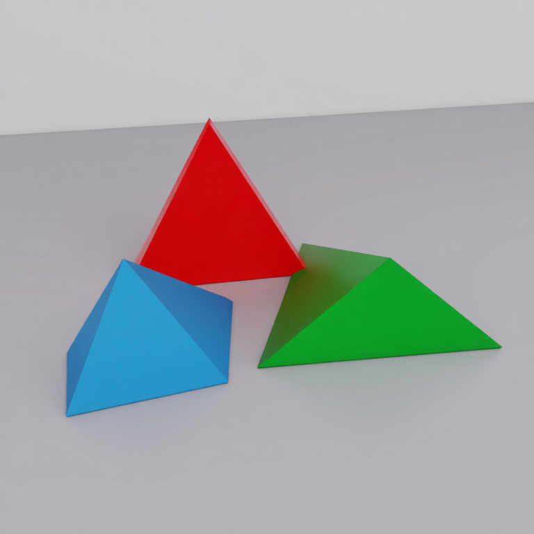
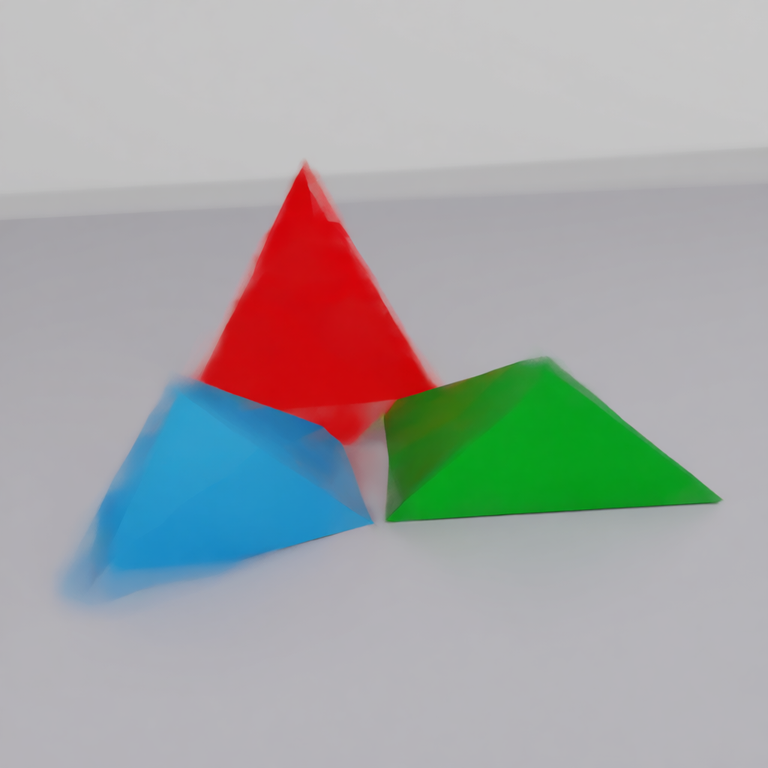
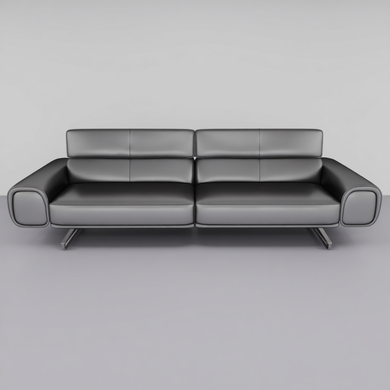
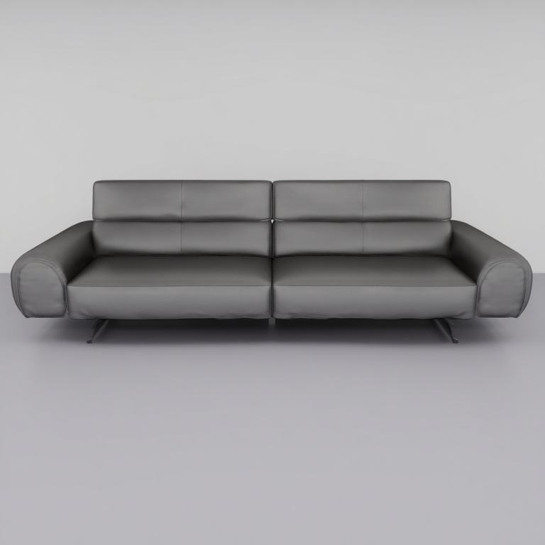
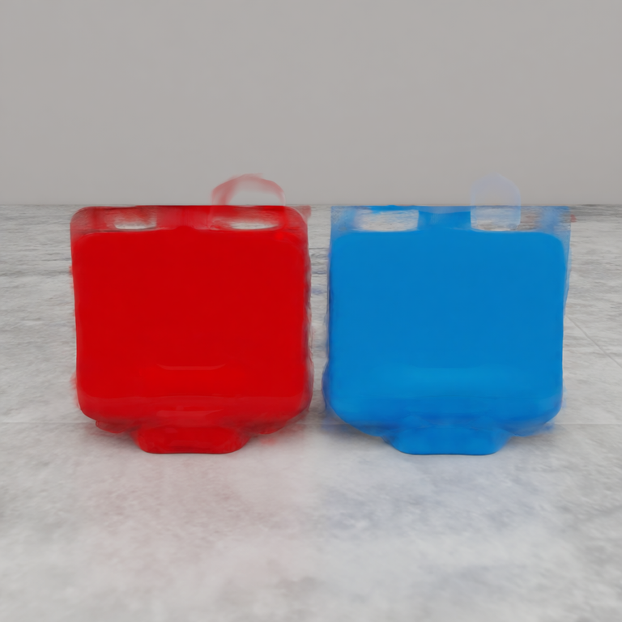
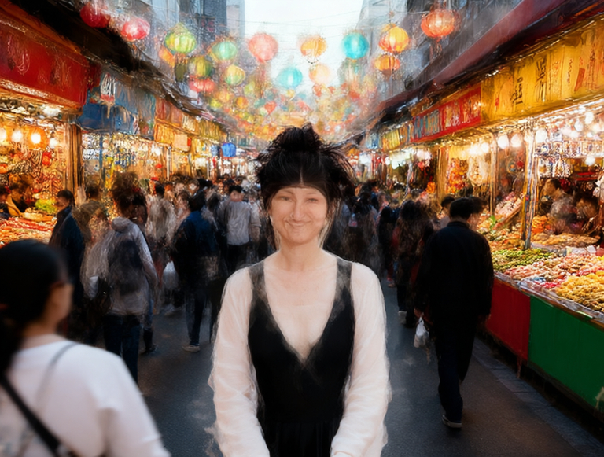
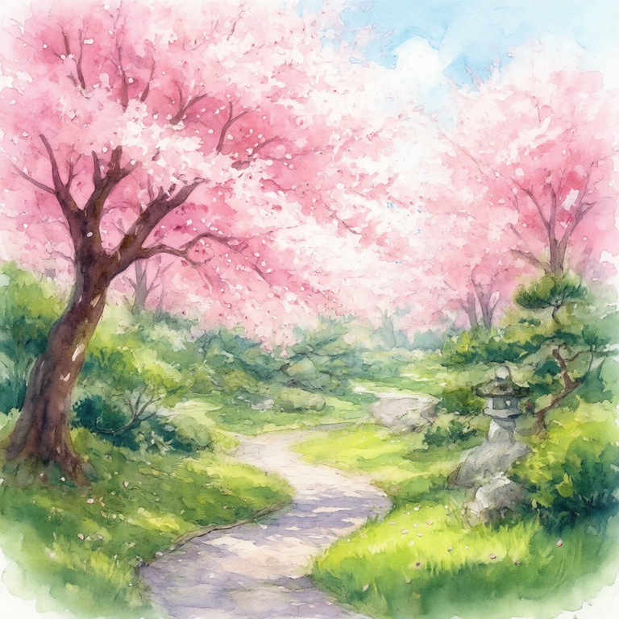
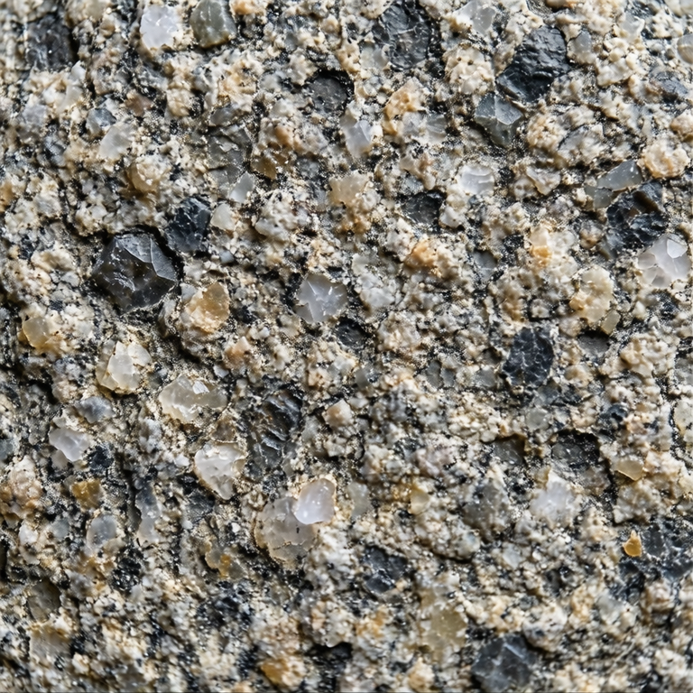
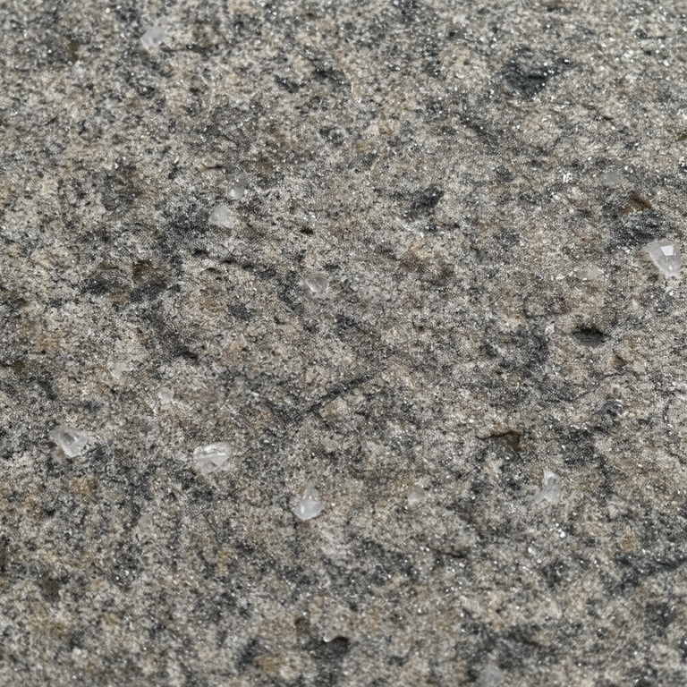

# Curated Examples

Selected from the M9 validation suite (18 cases, 4 configurations each). Each pair shows the baseline output (full 40-step CFG, 80 transformer passes) alongside the combined accelerated output (2.35x speedup, 34 passes).

All examples are from the **Qwen-Image-Edit-2511** track. Kontext output images are not included in the repository; Kontext quality is characterized numerically in [results.md](../results.md).

## Success Cases

These cases maintain high structural fidelity under 2.35x acceleration.

### Arrangement (3-image, SSIM 0.955)

Geometric shape arrangement. Structural content is fully preserved --- layout and shapes are established in the early full-compute steps.

| Baseline | Combined (2.35x) |
|---|---|
|  |  |

### Object Replacement (2-image, SSIM 0.949)

Furniture swap in a room scene. Semantic content (which object, where) is maintained precisely.

| Baseline | Combined (2.35x) |
|---|---|
|  |  |

### Object Placement (2-image, SSIM 0.947)

Objects placed on a table surface. Spatial layout and object identity well preserved.

| Baseline | Combined (2.35x) |
|---|---|
|  |  |

## Failure Cases

These cases show visible quality degradation. The accelerated output diverges from baseline in texture, detail, or artistic fidelity. The same content types (style transfer, fine texture, complex scenes) also degrade on FLUX Kontext-dev, confirming this as a method limitation.

### Complex Scene (3-image, SSIM 0.637)

Bustling market scene with many fine-grained elements. Multiple overlapping details degrade when mid-trajectory computation is pruned.

| Baseline | Combined (2.35x) |
|---|---|
|  |  |

### Style Transfer (1-image, SSIM 0.642)

Watercolor painting generation. Artistic detail and texture require the full mid-trajectory refinement that acceleration skips.

| Baseline | Combined (2.35x) |
|---|---|
|  |  |

### Material Texture (1-image, SSIM 0.665)

Granite surface with fine texture patterns. Surface detail degrades substantially --- the acceleration drops steps critical for texture refinement.

| Baseline | Combined (2.35x) |
|---|---|
|  |  |
