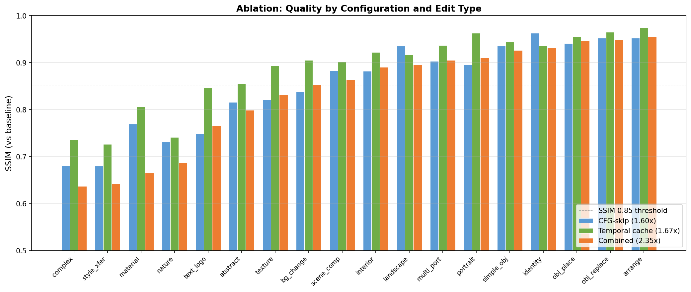
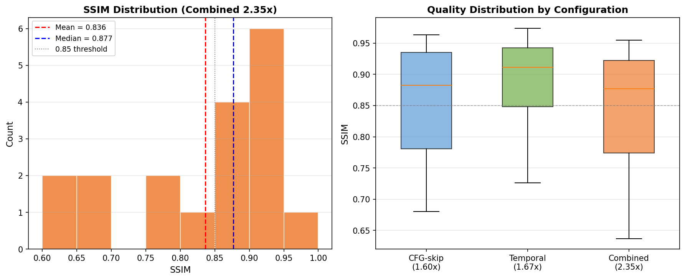
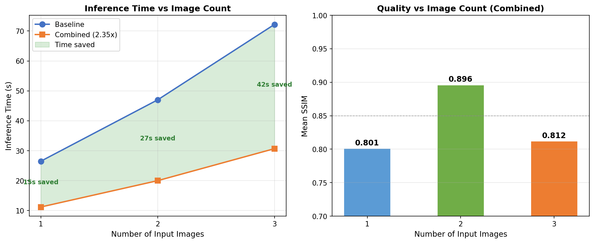

# M9 Validation Results

## Ablation Table

Speedup and quality (SSIM vs. baseline) for each configuration, measured on 18 test cases.

| Configuration | Speedup | Mean SSIM | Std SSIM | Range | Mean LPIPS |
|---|---|---|---|---|---|
| CFG-skip only | 1.60x | 0.851 | 0.092 | 0.680 - 0.963 | 0.170 |
| Temporal cache only | 1.67x | 0.885 | 0.080 | 0.726 - 0.974 | 0.143 |
| Fixed combined | 2.35x | 0.836 | 0.108 | 0.637 - 0.955 | 0.215 |

Temporal caching is the better single axis (+0.034 SSIM over CFG-skip at slightly higher speedup). Combining the two does not compound quality loss: predicted independent SSIM would be ~0.753, but actual combined SSIM is 0.836. The components have overlapping vulnerability — features sensitive to one method tend to be sensitive to both.

## Full Per-Case Results

| Case | Images | Type | Difficulty | CFG SSIM | Temporal SSIM | Combined SSIM | Combined LPIPS |
|---|---|---|---|---|---|---|---|
| tc04_3img_arrange | 3 | arrangement | easy | 0.952 | 0.974 | 0.955 | 0.109 |
| tc14_2img_replace | 2 | object_replacement | medium | 0.952 | 0.965 | 0.949 | 0.049 |
| tc01_2img_objects | 2 | object_placement | easy | 0.941 | 0.955 | 0.947 | 0.101 |
| tc13_2img_identity | 2 | identity_preserving | hard | 0.963 | 0.936 | 0.931 | 0.118 |
| tc08_1img_simple | 1 | simple_object | easy | 0.935 | 0.944 | 0.926 | 0.124 |
| tc12_1img_portrait | 1 | portrait | medium | 0.895 | 0.963 | 0.911 | 0.098 |
| tc06_3img_portrait | 3 | multi_portrait | medium | 0.903 | 0.937 | 0.905 | 0.147 |
| tc02_1img_landscape | 1 | landscape | medium | 0.935 | 0.917 | 0.895 | 0.112 |
| tc16_3img_interior | 3 | interior_design | medium | 0.882 | 0.922 | 0.890 | 0.148 |
| tc03_2img_scene | 2 | scene_composition | hard | 0.883 | 0.902 | 0.864 | 0.180 |
| tc15_2img_background | 2 | background_change | medium | 0.838 | 0.905 | 0.853 | 0.247 |
| tc05_2img_texture | 2 | texture_detail | hard | 0.821 | 0.893 | 0.832 | 0.204 |
| tc18_3img_abstract | 3 | abstract | medium | 0.816 | 0.855 | 0.799 | 0.345 |
| tc10_1img_text | 1 | text_logo | hard | 0.749 | 0.846 | 0.766 | 0.274 |
| tc07_3img_nature | 3 | nature_scene | hard | 0.731 | 0.741 | 0.687 | 0.304 |
| tc11_1img_material | 1 | material_texture | hard | 0.769 | 0.806 | 0.665 | 0.509 |
| tc09_1img_style | 1 | style_transfer | hard | 0.680 | 0.726 | 0.642 | 0.439 |
| tc17_3img_complex | 3 | complex_scene | hard | 0.681 | 0.736 | 0.637 | 0.364 |
| **Mean** | | | | **0.851** | **0.885** | **0.836** | **0.215** |

## Quality Distribution (Combined 2.35x)

The quality distribution is bimodal:

- **SSIM > 0.90**: 7/18 cases (39%) — good preservation
- **SSIM > 0.85**: 11/18 cases (61%) — acceptable preservation
- **SSIM < 0.80**: 6/18 cases (33%) — noticeable degradation
- **SSIM < 0.70**: 4/18 cases (22%) — significant degradation

Percentiles: p10 = 0.642, p25 = 0.766, p50 = 0.890, p75 = 0.926, p90 = 0.949

The median (0.890) is substantially higher than the mean (0.836), reflecting left skew from a cluster of hard cases.

## Image-Count Scaling

Speedup is constant at 2.35x regardless of input image count. Absolute time savings scale linearly with baseline cost.

| Input Images | Baseline (s) | Accelerated (s) | Time Saved (s) | Mean SSIM |
|---|---|---|---|---|
| 1 | 26.5 | 11.2 | 15.2 | 0.801 |
| 2 | 47.0 | 20.0 | 27.0 | 0.896 |
| 3 | 72.2 | 30.7 | 41.5 | 0.812 |

2-image cases show the best quality (0.896 mean SSIM). The lower quality for 1-image and 3-image groups is confounded by test case difficulty — those groups contained more hard cases (style transfer, material texture, complex scenes). Difficulty is a stronger predictor than image count.

## Failure Pattern Summary

### What is robust

Content with structural or semantic focus maintains high quality under acceleration:

- **Object placement/replacement** (SSIM 0.95): Layout established in early full-compute steps
- **Portraits / identity edits** (SSIM 0.91-0.93): Structural content preserved
- **Arrangements** (SSIM 0.96): Geometric content resilient to mid-trajectory pruning

### What is fragile

Content demanding fine visual detail degrades substantially:

- **Complex scenes** (SSIM 0.64): Multiple fine-grained elements
- **Style transfer** (SSIM 0.64): Artistic detail and texture
- **Material texture** (SSIM 0.67): Fine surface patterns
- **Nature scenes** (SSIM 0.69): Organic detail at multiple scales

### What predicts degradation

1. **Edit difficulty** is the strongest predictor: easy = 0.943, medium = 0.886, hard = 0.753 mean SSIM
2. **Visual complexity** of the target content — not image count, not prompt length
3. The acceleration prunes computation in mid-trajectory steps (5-34) where detail refinement occurs. Content that depends on these steps for fine structure will degrade.

| Difficulty | n | Mean SSIM | Std SSIM | Mean LPIPS |
|---|---|---|---|---|
| Easy | 3 | 0.943 | 0.012 | 0.111 |
| Medium | 7 | 0.886 | 0.044 | 0.164 |
| Hard | 8 | 0.753 | 0.105 | 0.299 |

### Current status

Content-adaptive routing (using difficulty or content-type signals to select between full compute and accelerated mode) is under investigation as a path to production-viable deployment.
